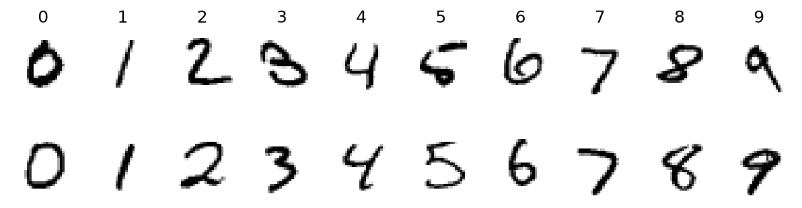
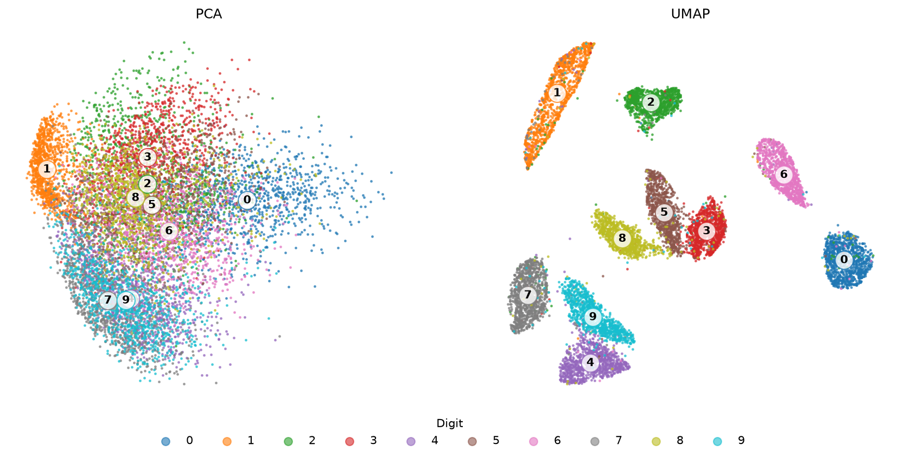

# Dimensionality reduction on handwritten digits

Just saw a random Linkedin post that visaulised a 2-dimensional representation of handwritten digits. Thought it looked cool, so implementing it myself with some dimensionality reduction algorithms: PCA, UMAP, and an autoencoder.

# Dataset

28x28 grayscale images of handwritten digits taken from MNIST.

# Results

So far, between PCA and UMAP

